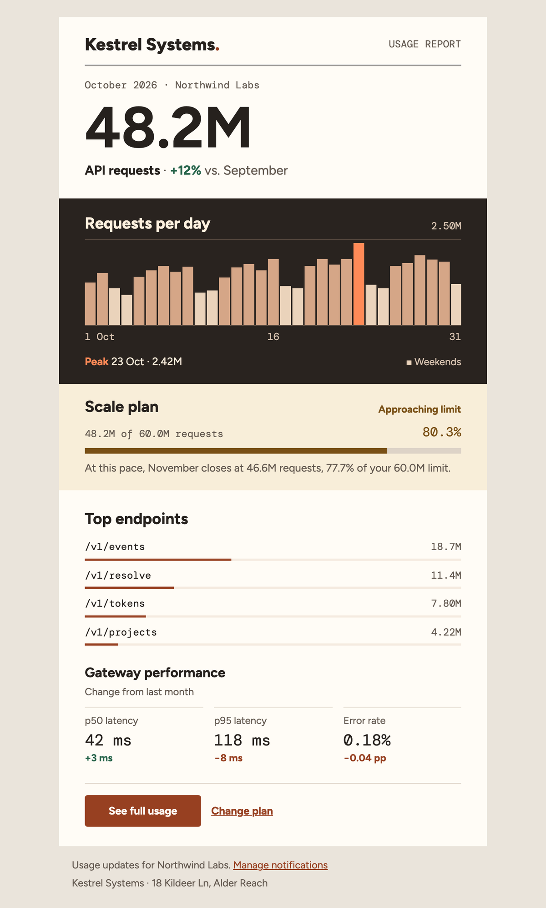
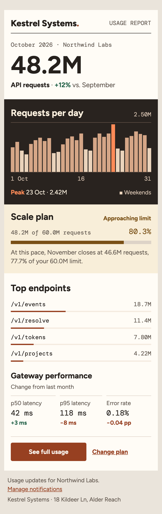
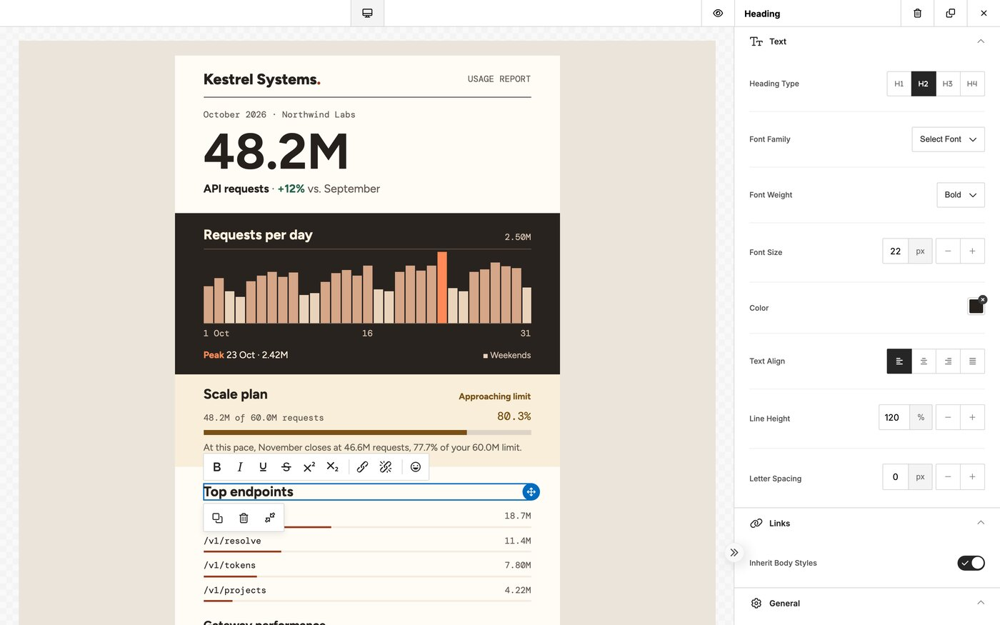
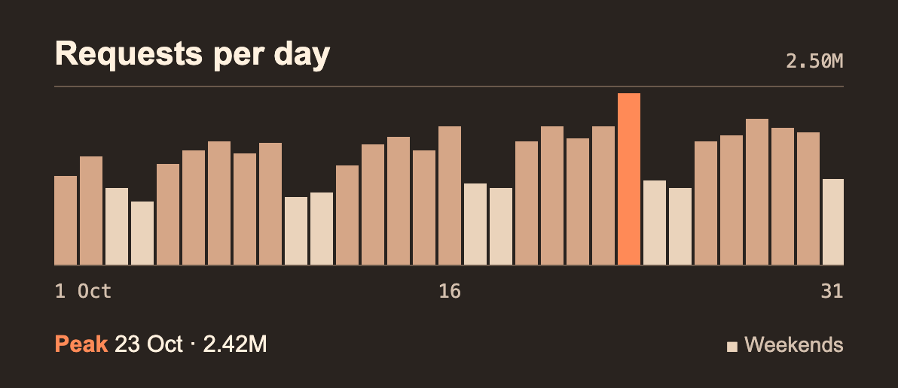

# Kestrel monthly usage report

**A monthly usage email with a chart made of table cells so classic Outlook can draw every day.**

<p>
  <a href="docs/kestrel-desktop.png"></a>
  <a href="docs/kestrel-phone.png"></a>
</p>

## Why it exists

People who pay by the request, message, GB, or build minute need to know what changed and whether their plan will cover next month. This template turns one month of daily usage into an email with a forecast and a link to act on it. The chart loads with the email, even when image downloads are blocked.

## Use it

Install the dependencies and render the gallery example and the three values files. The build writes HTML and plain text to `out/` and captures desktop and phone views when Chromium is available.

```sh
git clone https://github.com/adityasarade/hyper-elements-usage-email.git
cd hyper-elements-usage-email
npm ci
npx playwright install chromium
npm run build
```

Pass checked data to the component in your app. Use the returned `html` and `text` as the two parts of a transactional email.

```tsx
import { render } from "@hyper-elements/react";
import KestrelUsageReport from "./src/kestrel-usage-report";
import UsageReport from "./templates/usage-report";
import morrow from "./designs/morrow-february.values.json" with { type: "json" };

const { valid, values } = UsageReport.check(morrow.values);
if (!valid || !values) throw new Error("Invalid usage report values");
const { html, text } = await render(<KestrelUsageReport data={values} />);
```

To fill the template from the CLI, copy the `values` object from an example into `usage.json`. Supply one value per UTC day of a completed calendar month, then run:

```sh
npx hyper-elements describe templates/usage-report.tsx
npx hyper-elements design new templates/usage-report.tsx --values usage.json -o designs/your-workspace.values.json
npm run build -- designs/your-workspace.values.json
```

## How Hyper Elements is used

- **Daily chart.** An `Email` lays out a `Row stackOnMobile={false}` with one colored `Column` per day. The height comes from that day’s usage, weekends use a lighter shade, and the peak gets a separate color and caption. The chart’s accessible summary also goes into the plain-text part.
- **Plan and forecast.** The meter is calm below 80%, warns from 80% through 100%, and switches to an over-limit state above 100%. Two cells show the included usage and the excess. The primary button switches to **Upgrade plan** when there’s an overage. The forecast uses the month’s average daily usage and next month’s calendar to give a closing total or the expected date of the first overage.
- **Template fields.** Set the company, postal address, billing unit, headline label, and breakdown title and name style. Breakdown names can be up to 48 characters. Add up to three performance figures with optional previous values. `kestrel.UsageReport` checks calendar coverage, language, preview text, link text, contrast and layout. Each destination must use an exact hostname from the filler’s company domain list. Version 2 reads version 1 values files through a migration.

```tsx
<Column style={{
  height: barHeight(count),
  backgroundColor: count === 0 ? undefined : index === peakIndex ? PEAK : weekend ? WEEKEND : WEEKDAY,
}} />
```

## Edit it in Unlayer's builder

Run `npm run design-json`, then pass `out/kestrel-usage-report.design.json` to the editor’s `loadDesign()`. The export uses `toDesign()` from `@hyper-elements/react/builder`.

The wordmark, headline number, headings, captions, paragraphs, breakdown names and counts, performance figures, buttons, and footer links load as editable builder tools. The six HTML blocks in the gallery example are the daily chart, the plan meter, and four breakdown bars. Move those blocks in the editor or change the source values and export again to recalculate them and their labels.



## Views

### Classic Outlook for Windows

All 31 bars survive as colored table cells in the Hyper Elements emulator.

[](docs/chart-outlook.png)

### Outlook for Mac in dark mode

The dark-mode emulator recolors the report. The peak and plan warning are both labeled in text.

<p>
  <a href="docs/outlook-mac-dark.png"></a>
</p>

```sh
npx hyper-elements preview src/kestrel-usage-report.tsx --clients outlook,outlook-mac --dark
```

Open `outlook.html` and `outlook-mac.dark.html` under `out/clients/src/kestrel-usage-report/` for the emulator previews.

### More datasets

| Report | Result | Phone view |
| --- | --- | --- |
| [Morrow Works](designs/morrow-february.values.json) | Two zero-traffic days and 13.7% of the plan used | [Open](docs/morrow-phone.png) |
| [Postern Mail](designs/postern-june.values.json) | 1.30M emails sent, plain-text sender names, performance section omitted | [Open](docs/postern-phone.png) |
| [Northwind over the limit](designs/northwind-over-limit.values.json) | 126.8% of the plan used, 10.2M requests over, and an upgrade button | [Open](docs/northwind-over-limit-phone.png) |

The [October plain-text part](docs/kestrel.txt) includes the exact totals for the busiest day, the quietest day, and each seven-day slice of the month.

## Checks

| Command | Result |
| --- | --- |
| `npm run build` | 4 renders with 0 errors and 0 warnings |
| `npx hyper-elements check src templates designs` | 5 designs with 0 errors, 0 warnings, and 0 skipped |
| `npx tsc --noEmit` | Exit 0 |
| `npm run design-json` | 6 HTML fallbacks, all for charts or bars |

The two build notes cover web-font and phone-style support in some clients. Fallback fonts and the base table layout keep the report readable there.

## Add it to the gallery

Copy [`src/kestrel-usage-report.tsx`](src/kestrel-usage-report.tsx) to `apps/website/examples/templates/`. It has the gallery’s `meta` and renders with no props.

## License

[MIT](LICENSE). Figtree and DM Mono are Google Fonts distributed under the SIL Open Font License.
