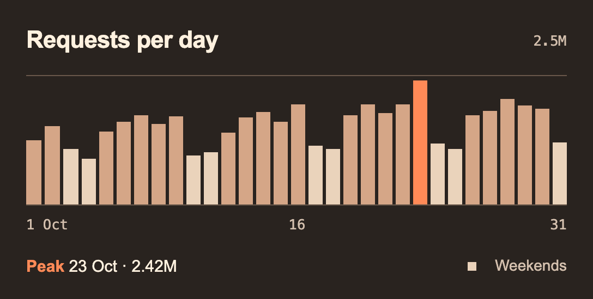
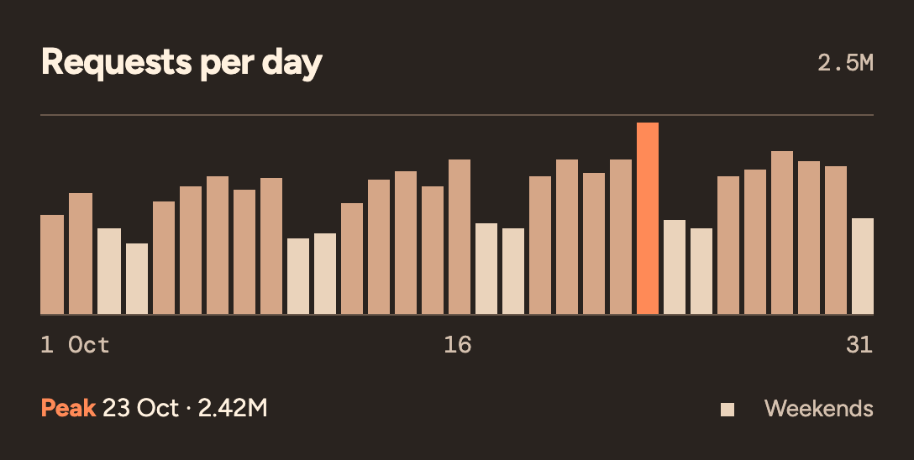

# Kestrel monthly usage report

**A Hyper Elements template for a monthly usage email: requests per day as a bar chart built from table cells, so classic Outlook draws it too, and how near the plan’s limit the workspace is. No images.**

<p>
  <a href="docs/kestrel-desktop.png"></a>
  <a href="docs/kestrel-phone.png"></a>
</p>

## Why it exists

Usage emails should tell an operator what changed, when traffic peaked, and whether the workspace is on pace to hit its limit. Kestrel puts those answers in the inbox and gives the recipient a link to the underlying usage. The chart needs no image downloads.

## Use it

Install and build the gallery example. The Chromium install enables screenshots from the build.

```sh
npm ci
npx playwright install chromium
npm run build
```

In your app, pass the workspace’s data to the same component. The returned `html` and `text` are the two parts of the email.

```tsx
import { render } from "@hyper-elements/react";
import KestrelUsageReport from "./src/kestrel-usage-report";
import morrow from "./designs/morrow-february.values.json";

const { html, text } = await render(<KestrelUsageReport data={morrow.values} />);
```

To prepare a report through the template, use the `values` object in the Morrow example as a starting point for `usage.json`. Fill it with one completed UTC calendar month.

```sh
npx hyper-elements describe templates/usage-report.tsx
npx hyper-elements design new templates/usage-report.tsx --values usage.json -o designs/your-workspace.values.json
npx hyper-elements render designs/your-workspace.values.json
```

## How Hyper Elements is used

- **Daily traffic.** `Email` renders layout tables. Each day is one empty `Column` inside a `Row stackOnMobile={false}`. The table cell gets a numeric height and a background color. Weekends are lighter and the peak is orange. A visible peak caption and a chart summary in the text part give readers the numbers behind the bars.
- **Plan and endpoints.** Two side-by-side cells split each meter by percentage. The plan uses total requests divided by the limit. The endpoint bars use each route’s share of all requests. The forecast carries this month’s average daily usage and plan limit into the next calendar month.
- **Template.** `kestrel.UsageReport` bounds the fields and checks that the report has one whole count per day. Its required rules cover link text, language, contrast, preview text and layout overflow. The three workspace links must point to `kestrel.example`.

```tsx
<Column style={{
  height: Math.round(plotHeight * requests / ceiling),
  backgroundColor: index === peakIndex ? PEAK : weekend ? WEEKEND : WEEKDAY,
}} />
```

## Views

### Chart in email clients

Playwright screenshots of the first message frame in the Hyper Elements client emulator. The Outlook and Gmail previews use fallback fonts. All three retain the 31 bars and the highlight on 23 October.

| Classic Outlook for Windows | Gmail on the web | Apple Mail on Mac |
| --- | --- | --- |
| [](docs/chart-outlook.png) | [](docs/chart-gmail.png) | [](docs/chart-apple-mail.png) |

Generate these preview HTML files with `npx hyper-elements preview src/kestrel-usage-report.tsx --clients outlook,gmail,apple-mail`. They go to `out/clients/src/kestrel-usage-report/`.

### A quieter workspace

Morrow Works made 274,486 requests across 28 days, with two zero-traffic days. Its 13.7% plan meter and February chart come from [the values file](designs/morrow-february.values.json). [Open its phone view](docs/morrow-phone.png).

### Plain text

The text part includes exact numbers for the busiest and quietest days and totals for each seven-day slice of the month. [Read the October text part](docs/kestrel.txt).

## Checks

| Command | Result |
| --- | --- |
| `npm run build` | `✓ src/kestrel-usage-report.tsx (Email): 0 errors and warnings, 11 notes` |
| `npx hyper-elements check templates designs` | `2 designs: 0 errors, 0 warnings, 0 skipped` |
| `npx tsc --noEmit` | Exit 0 |

## Add it to the gallery

Copy `src/kestrel-usage-report.tsx` to `apps/website/examples/templates/`. It has the gallery’s `meta` and renders with no props.

## License

[MIT](LICENSE). Figtree and DM Mono are Google Fonts distributed under the SIL Open Font License.
