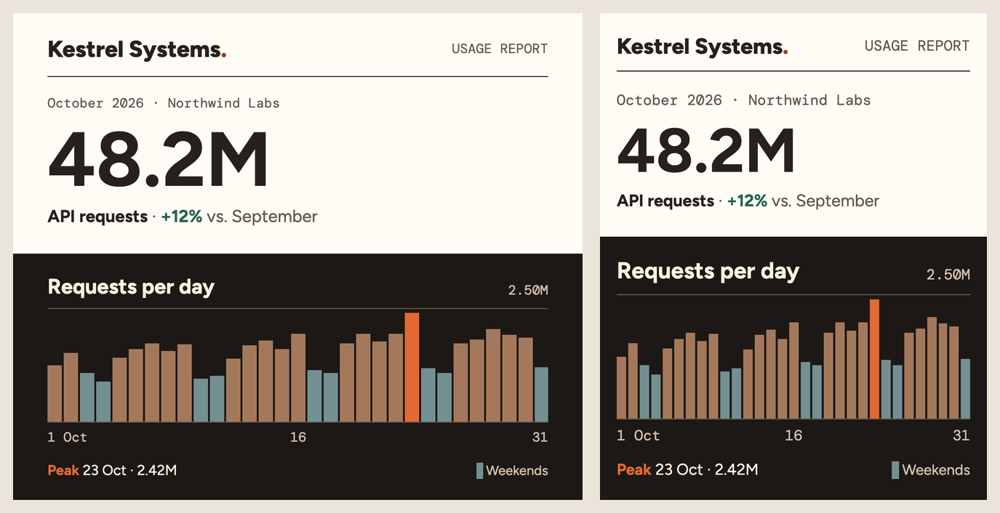
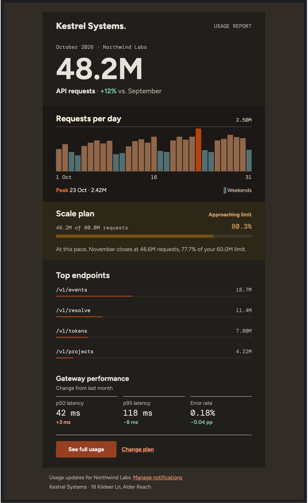
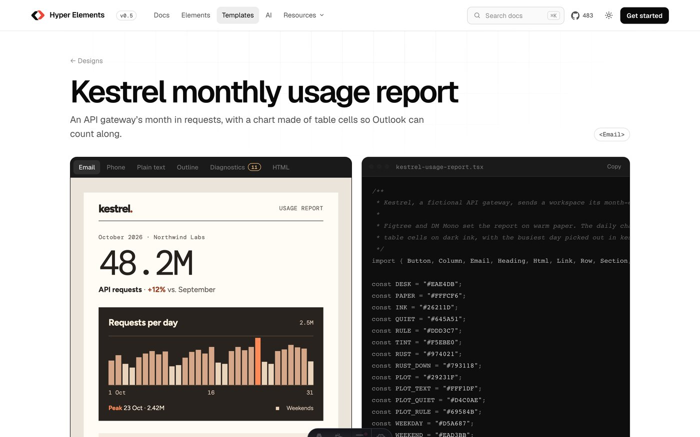

# Kestrel monthly usage report

A monthly API usage email with one table cell per day, so classic Outlook can draw the chart with image downloads turned off.



## Use it

From the root of a fresh clone, run these three commands.

```sh
npm ci
npx playwright install chromium
npm run build
```

Open `out/kestrel-usage-report.html` for the gallery example. The build also renders the three values files in `designs/`, writes a plain-text part for each report, and captures desktop and phone PNGs when Chromium can start.

A billing team can use the daily totals it already collects to show customers what changed, how much of their plan they used, and when the same pace would take them over their limit. The customer can open their usage details or change plans from the email.

Pass checked data to the component in your app. Use the returned `html` and `text` as the two parts of a transactional email.

```tsx
import { render } from "@hyper-elements/react";
import KestrelUsageReport from "./src/kestrel-usage-report";
import UsageReport from "./templates/usage-report";
import morrow from "./designs/morrow-february.values.json" with { type: "json" };

const { valid, values, diagnostics } = UsageReport.check(morrow.values);
if (!valid || !values) throw new Error(diagnostics.map(d => d.message).join("\n"));
const { html, text } = await render(<KestrelUsageReport data={values} />);
```

To fill the template from the CLI, copy the `values` object from an example into `usage.json`. Supply one value per UTC day of a completed calendar month.

```sh
npx hyper-elements describe templates/usage-report.tsx
npx hyper-elements design new templates/usage-report.tsx --values usage.json -o designs/your-workspace.values.json
npm run build -- designs/your-workspace.values.json
```

## Edit it in Unlayer's builder

Run `npm run design-json`, then pass `out/kestrel-usage-report.design.json` to the editor’s `loadDesign()`. The export uses `toDesign()` from `@hyper-elements/react/builder`.

The wordmark, headline number, headings, captions, paragraphs, breakdown names and counts, performance figures, buttons, and footer links load as editable builder tools. The six HTML blocks in the gallery example are the daily chart, the plan meter, and four breakdown bars. Move those blocks in the editor or change the source values and export again to recalculate them and their labels.


## How Hyper Elements is used

- **Daily chart.** An `Email` lays out a `Row stackOnMobile={false}` with one colored `Column` per day. The height comes from that day’s usage, weekdays are clay, weekends are blue-gray, and the peak gets a separate color and caption. The chart’s accessible summary also goes into the plain-text part.
- **Plan and forecast.** The meter is calm below 80%, warns from 80% through 100%, and switches to an over-limit state above 100%. Two cells show the included usage and the excess. The primary button switches to **Upgrade plan** when there’s an overage. The forecast uses the month’s average daily usage and next month’s calendar to give a closing total or the expected date of the first overage.
- **Template fields.** Set the company, postal address, billing unit, headline label, and breakdown title and name style. Breakdown names can be up to 48 characters. The billing month can’t be in the future. The daily list must cover its exact number of days, including leap days. Each breakdown name must be distinct, and the counts together must fit within the monthly total. The template also checks language, preview text, link text, contrast and layout. Each destination must use an exact hostname from the filler’s company domain list. Version 2 reads version 1 values files through a migration.
- **Performance figures.** Up to three figures can include a previous value. Set `better` to `"lower"` for latency or error rate (the default), or `"higher"` for a metric such as uptime. Green marks improvement, rust marks regression, and equal values read “Unchanged.” The sign shows the direction of change. A move from 0.22% to 0.18% reads “−0.04 pp.”

```tsx
<Column style={{
  height: barHeight(count),
  backgroundColor: count === 0 ? undefined : index === peakIndex ? PEAK : weekend ? WEEKEND : WEEKDAY,
}} />
```

## Views

Read the full October report on [desktop](docs/kestrel-desktop.png) or [phone](docs/kestrel-phone.png). The Outlook captures below show the previous palette. The preview command renders the current one.

### Classic Outlook for Windows

All 31 bars survive as colored table cells in the Hyper Elements emulator.

[](docs/chart-outlook.png)

### Outlook for Mac in dark mode

The dark-mode emulator recolors the report. The peak and plan warning are both labeled in text.

<p>
  <a href="docs/outlook-mac-dark.png"></a>
</p>

```sh
npx hyper-elements preview src/kestrel-usage-report.tsx --clients outlook,outlook-mac,gmail,apple-mail --dark
```

Open the HTML files under `out/clients/src/kestrel-usage-report/` to compare classic Outlook (`outlook.html`), Outlook for Mac (`outlook-mac.dark.html`), Gmail (`gmail.html`), or Apple Mail (`apple-mail.html`).

### More datasets

| Report | Result | Phone view |
| --- | --- | --- |
| [Morrow Works](designs/morrow-february.values.json) | Two zero-traffic days and 13.7% of the plan used | [Open](docs/morrow-phone.png) |
| [Postern Mail](designs/postern-june.values.json) | 1.30M emails sent, plain-text sender names, performance section omitted | [Open](docs/postern-phone.png) |
| [Northwind over the limit](designs/northwind-over-limit.values.json) | 126.8% of the plan used, 10.2M requests over, and an upgrade button | [Open](docs/northwind-over-limit-phone.png) |

The [October plain-text part](docs/kestrel.txt) includes the exact totals for the busiest day, the quietest day, and each seven-day slice of the month.

## Checks

| Command | Result |
| --- | --- |
| `npm run build` | 4 renders with 0 errors and 0 warnings |
| `npx hyper-elements check src templates designs` | 5 designs with 0 errors, 0 warnings, and 0 skipped |
| `npx tsc --noEmit` | Exit 0 |
| `npm run design-json` | 6 HTML fallbacks, all for charts or bars |
| `npm test` | 3 regression tests passed for validation, fractional usage and delta colors |

The two build notes cover web-font and phone-style support in some clients. Fallback fonts and the base table layout keep the report readable there.

## Add it to the gallery

Copy [`src/kestrel-usage-report.tsx`](src/kestrel-usage-report.tsx) to `apps/website/examples/templates/`. It has the gallery's `meta` and renders with no props.

The screenshot shows an earlier version of this report rendered by the gallery’s own generator (`pnpm generate`) and dev server at `/templates/kestrel-usage-report` in a local checkout.



## License

[MIT](LICENSE). Figtree and DM Mono are Google Fonts distributed under the SIL Open Font License.
